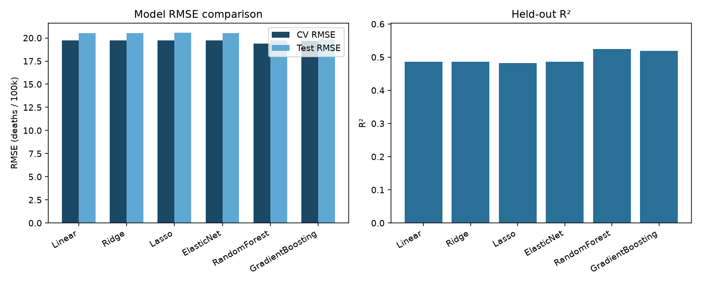
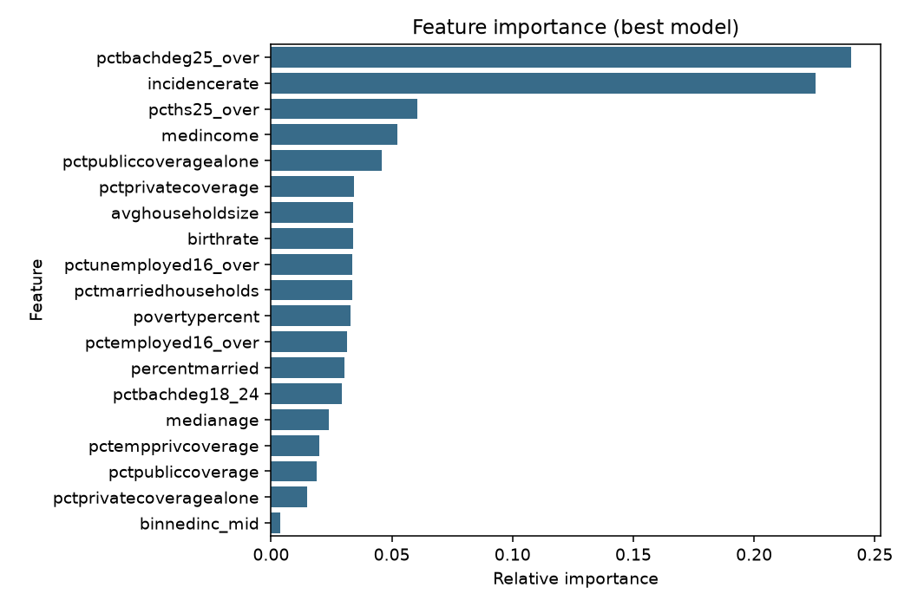

# Cancer Death Rate Regression

[](https://huggingface.co/spaces/waleedarif1011/cancerregression)
[](https://github.com/waleedarif1011/cancerregression/actions/workflows/ci.yml)
[](LICENSE)

Predict **US county cancer death rates** (`target_deathrate` per 100,000) from socioeconomic and health indicators. The repo ships a six-model regularized / ensemble benchmark, saved sklearn pipeline, and a live **County Risk Explorer** Gradio demo.

> **Live demo:** after the Hugging Face Space is created (see [Deploy](#deploy-hugging-face-space)), open the badge URL above. Until then, run locally with `python app.py`.

## Results (held-out 20%, 5-fold CV on train)

| Model | CV RMSE | Test RMSE | MAE | R² |
|-------|---------|-----------|-----|----|
| Linear | 19.73 | 20.49 | 15.22 | 0.487 |
| Ridge | 19.73 | 20.49 | 15.22 | 0.487 |
| Lasso | 19.73 | 20.57 | 15.27 | 0.483 |
| ElasticNet | 19.73 | 20.52 | 15.22 | 0.486 |
| **RandomForest** | **19.41** | **19.73** | **14.36** | **0.524** |
| GradientBoosting | 19.69 | 19.84 | 14.63 | 0.519 |

Best model by R²: `RandomForest`. Full numbers: [`artifacts/metrics.json`](artifacts/metrics.json). National median death rate in the dataset: **178.1** per 100k.

### Model comparison & feature importance





## Quickstart

```bash
python -m pip install -r requirements.txt
python -m src.train          # train + write artifacts/ and assets/
python app.py                # Gradio demo at http://127.0.0.1:7860
```

### CLI inference

```bash
python -m src.predict \
  --incidencerate 450 --medincome 52000 --povertypercent 12 \
  --pctprivatecoverage 70 --medianage 40 --pctbachdeg25_over 18
```

Returns JSON with `predicted_deathrate`, comparison to the US national median, county percentile, and key risk drivers.

## Method (short)

- **Data:** `dataset/cancer_reg.csv` merged with `dataset/avg-household-size.csv` on `geography` (3,047 counties).
- **Features:** parse `binnedinc` intervals → midpoint; drop columns with >50% missing (`pctsomecol18_24`); median-impute `pctemployed16_over` / `pctprivatecoveragealone`; 1–99% outlier clipping; top socioeconomic + incidence features (excludes near-leakage counts).
- **Split:** 80/20 train/test (`random_state=42`) with 5-fold CV RMSE on the train fold.
- **Models:** Linear, Ridge, Lasso, ElasticNet, Random Forest, Gradient Boosting — winner saved to `artifacts/cancer_model.joblib`.
- **Demo:** Gradio County Risk Explorer with 10 interactive indicators + 3 held-out county presets (lower / median / higher predicted risk).

## Tests & CI

```bash
python -m pytest -q
```

GitHub Actions runs the same suite on every push/PR (`.github/workflows/ci.yml`).

## Deploy (Hugging Face Space)

This repo is Space-ready (`app.py` + Gradio README frontmatter). Create and push:

```bash
# once: huggingface-cli login   # needs a write token with Spaces scope
huggingface-cli repo create cancerregression --type space --space_sdk gradio -y
git remote add space https://huggingface.co/spaces/waleedarif1011/cancerregression
git push space HEAD:main
```

Step-by-step: [`docs/hf-space-deploy.md`](docs/hf-space-deploy.md).

## Layout

```
app.py                 Gradio County Risk Explorer (3 presets)
src/features.py        binnedInc parsing, impute, clip, feature select
src/train.py           6-model benchmark + metrics/plots
src/predict.py         CLI + national-median comparison
dataset/               cancer_reg.csv + avg-household-size.csv
artifacts/             cancer_model.joblib + metrics.json
assets/                model_comparison + feature_importance plots
notebooks/             original exploratory notebook
tests/                 pytest suite
```

## License

MIT — see [`LICENSE`](LICENSE).
